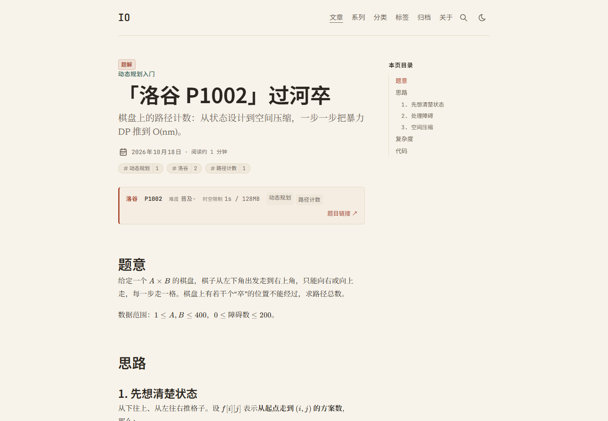
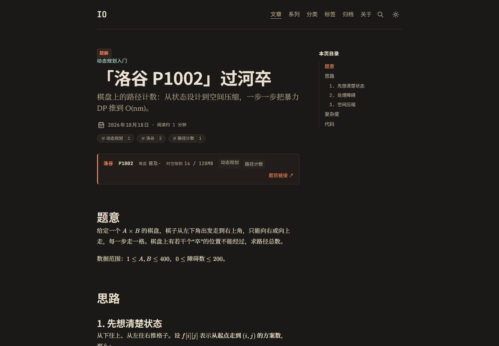
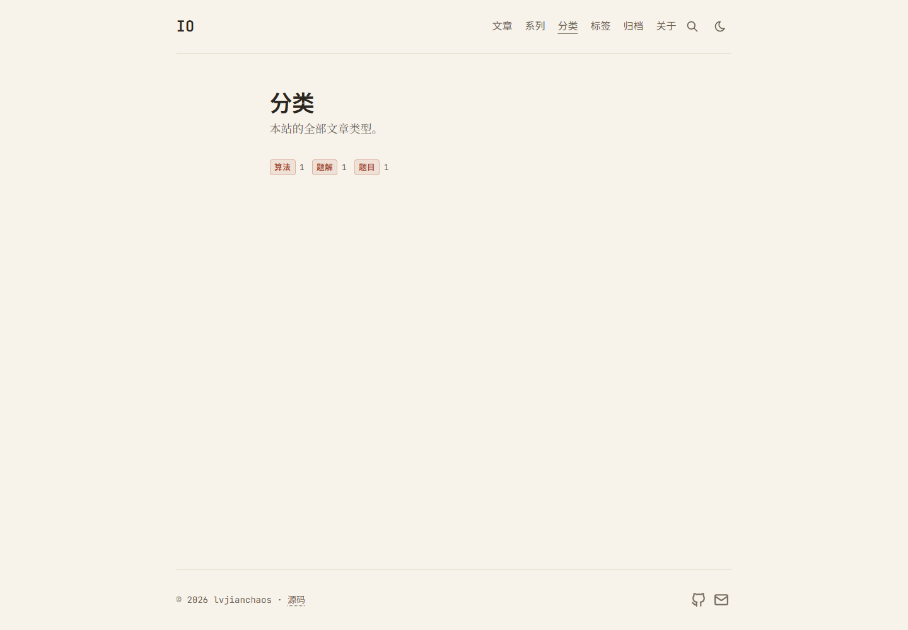

# astro-chaos

主站的**算法分站**：算法题解、算法笔记，以及一些值得留存的题目。

- 站点：`https://io.chaos-ljc.top/`
- 主站（Fuwari 主题）：`https://blog.chaos-ljc.top/`

| 亮色 | 暗色 |
| --- | --- |
|  |  |
|  |  |
|  | |

本站基于 [AstroSage](https://github.com/chintak/astro-sage) 开发。AstroSage 本身是
[AstroPaper](https://github.com/satnaing/astro-paper) 的重构版，提供了衬线排版、固定目录、
KaTeX、Expressive Code、Mermaid/Excalidraw 构建期渲染、系列（Series）、Pagefind 等能力。

**我们在这个基座上做的四件事**：

1. **中文阅读体验** —— 中文字体栈、按"全角字"计算的栏宽、中文标点处理、全中文界面与配色。
2. **内容分类模型** —— 在 `tags` 与 `series` 之外新增 `category`（文章类型）。
3. **算法特化** —— 竞赛模板代码、复杂度表格、题面信息写在正文开头。
4. **做减法** —— 去掉文章分享按钮、选段分享、OG 社交预览图，站点只管阅读。

这份 README 同时是主题的参考手册：配置项、frontmatter、写作语法、路由都在下面。

---

## 目录结构

```
astro-chaos/
├── packages/astro-sage/   主题源码
│   ├── src/styles/         设计 token：中文排版、配色
│   ├── src/i18n/lang/      界面文案（en / zh-CN）
│   ├── src/routes/         注入的全部路由（含 /categories）
│   ├── src/markdown/       KaTeX、callout、wiki-link、图表等插件
│   └── src/components/     卡片、题目卡之外的 UI 组件
├── apps/site/              本站内容与配置
│   ├── sage.config.ts      站点配置
│   ├── src/content/posts/  文章（Markdown / MDX）
│   ├── src/content/pages/  页面（如关于页）
│   └── scripts/            开发脚本
└── pnpm-workspace.yaml
```

## 本地开发

需要 Node ≥ 22.12 与 [pnpm](https://pnpm.io)。

```bash
pnpm install
pnpm dev        # http://localhost:4321
pnpm build      # 类型检查 + 构建 + Pagefind 索引，产物在 apps/site/dist
pnpm preview
pnpm format     # prettier
pnpm lint       # oxlint
```

构建 Mermaid / Excalidraw 图需要 Chromium：没有 Playwright 自带的浏览器时会回退到系统
安装的 Chrome。CI 里执行 `pnpm --filter @io/site exec playwright install --with-deps chromium`。
渲染结果缓存在 `apps/site/.sage-cache/diagrams/`，**请提交该目录**，这样部署构建就不需要浏览器。

两个开发脚本（在 `apps/site/` 下，需要先 `pnpm build`）：

```bash
pnpm --filter @io/site exec node scripts/screenshot.mjs   # 截图（light/dark，可视回归）
pnpm --filter @io/site test:search                         # 中文搜索烟测
```

---

## 写一篇文章

### frontmatter

只有这几个字段（题面信息写进正文，不要塞进 frontmatter）：

| 字段 | 必填 | 作用 |
| --- | --- | --- |
| `title` | ✅ | 标题 |
| `description` | ✅ | 一句话摘要，用于列表、RSS 与 meta |
| `pubDatetime` | ✅ | 发布时间（定时发布靠它） |
| `category` | | 文章类型：`题解` / `题目` / `算法`（单选） |
| `tags` | | 横切特征：来源 OJ、题号、所用算法、语言……（多选） |
| `series` | | 有先后顺序的一组文章（单选） |
| `modDatetime` | | 显示"更新于" |
| `draft` | | `true` 时不构建 |
| `featured` | | 首页精选 |
| `toc` | | 是否显示右侧目录，默认 `true` |
| `math` | | 是否加载 KaTeX 样式，默认 `true`；纯文字文章可设 `false` |
| `cite` | | 是否显示"引用本文"块，默认 `true` |
| `comments` | | 是否显示评论，默认 `true`（需配置评论服务） |
| `slug` | | 覆盖 URL 片段（默认取文件路径） |
| `canonicalURL` / `timezone` / `hideEditPost` | | 杂项 |

```md title="apps/site/src/content/posts/p1002-guo-he-zu.md"
---
title: "「洛谷 P1002」过河卒"
description: "棋盘上的路径计数：从状态设计到空间压缩。"
pubDatetime: 2026-10-18T09:00:00+08:00
category: 题解
series: 动态规划入门
tags: [洛谷, P1002, 动态规划, 路径计数]
---

> - **题目**：洛谷 [P1002 过河卒](https://www.luogu.com.cn/problem/P1002) · 普及-
> - **时空限制**：1s / 128MB

正文……$O(n \log n)$……

```cpp title="P1002.cpp"
int main() {}
```
```

### 正文语法

| 功能 | 写法 |
| --- | --- |
| 数学 | `$…$` 行内、`$$…$$` 独立（KaTeX，构建期渲染，无 JS） |
| 代码 | 围栏代码块；meta 支持 `title="x.cpp"`、`{1-2}` 高亮行、`ins={4}` / `del={3}` 增删标记、`collapse={1-4}` 折叠、`showLineNumbers`；`bash`/`sh` 自动加终端外框；语言标签显示在边框上 |
| 图表 | ` ```mermaid ` 或 ` ```excalidraw `（JSON）；Excalidraw 也支持 `` 或 excalidraw.com 分享链接 |
| 宽图 | 围栏后加 `wide` / `full`，或图片标题写 ``；MDX 里可用 `<Figure src alt caption size="column\|wide\|full" />` |
| 提示块 | `> [!NOTE]`（NOTE / TIP / IMPORTANT / WARNING / CAUTION）或 `:::warning[标题]` … `:::`；不写标题时自动用中文（注意 / 提示 / 重要 / 警告 / 危险） |
| 引用 | `>`，可嵌套 |
| 列表 | `-` / `1.`；任务列表 `- [x]` 渲染成圆形勾选框 |
| 表格 | GFM；宽表可横向滚动 |
| 脚注 | `[^1]` |
| Wiki 链接 | `[[slug]]`、`[[slug\|文本]]`、`[[slug#小节]]`、`[[#小节]]`；按 slug、路径或标题匹配 |
| 行内元素 | `**粗体**`、`<mark>`、`<kbd>`、`H~2~O`、`x^2^`、`<abbr title>`；引号与破折号自动转排版符号 |
| 外链 | 自动加 ↗ 角标与 `rel="noopener"`；站内链接保持普通下划线 |

### 分类模型的分工

| 维度 | 字段 | 基数 | 例子 | 作用 |
| --- | --- | --- | --- | --- |
| 分类 | `category` | 单选 | 题解 / 题目 / 算法 | 文章类型，主导航 |
| 标签 | `tags` | 多选 | 洛谷 / P1002 / 动态规划 / C++17 | 横切特征，聚合检索 |
| 系列 | `series` | 有序多篇 | 动态规划入门 | 学习路径，"第 N 篇，共 M 篇" |

分类回答"这是哪类文章"，标签回答"它有什么特征"，系列回答"按什么顺序读"。

---

## 站点配置

`apps/site/sage.config.ts`：

| 键 | 默认值 | 说明 |
| --- | --- | --- |
| `site.url` | 必填 | 站点正式地址（写进 canonical、RSS、sitemap） |
| `site.title` / `description` / `author` | 必填 | 标题 / 描述 / 作者 |
| `site.profile` | — | 作者主页（用于结构化数据） |
| `site.repo` | — | 源码仓库地址（显示在页脚） |
| `site.lang` / `timezone` / `dir` | `"en"` / `"UTC"` / `"ltr"` | 语言、时区、书写方向 |
| `site.googleVerification` | 环境变量 | Google Search Console 验证码 |
| `typography.serif` | `"newsreader"` | 西文正文衬线体，另可选 `source-serif-4`、`literata` |
| `typography.opticalSizing` | `false` | 额外打包 opsz 轴（每个字重约多 70KB） |
| `typography.fallbacks` | 系统字体栈 | Web 字体加载失败时的回退 |
| `home.title` / `home.intro` | `site.title` / — | 首页标题与引言 |
| `posts.perPage` / `perIndex` | `4` / `4` | 列表页与首页每页条数 |
| `posts.scheduledPostMargin` | 15 分钟 | 定时发布提前量 |
| `features.lightAndDarkMode` | `true` | 亮/暗主题切换 |
| `features.showArchives` | `true` | `/archives` 与导航入口 |
| `features.showBackButton` | `true` | 文章页返回按钮 |
| `features.editPost` | `{ enabled: false }` | `{ enabled: true, url }` 显示"编辑此页" |
| `features.search` | `"pagefind"` | 设为 `false` 关闭搜索 |
| `socials` | `[]` | 站点社交图标，`name` 取 `src/assets/icons/socials/` 里的文件名 |
| `citation.enabled` / `author` / `publication` | `true` / 文章作者 / 站点域名 | "引用本文"块 |
| `comments` | `{ provider: false }` | `utterances` 或 `giscus`，默认关闭 |

社交图标可选：bluesky、facebook、github、hackernews、linkedin、mail、pinterest、reddit、
telegram、whatsapp、x。

## 路由

`/`、`/posts/`（分页）、`/posts/<slug>/`、`/tags/`、`/tags/<tag>/`、`/categories/`、
`/categories/<category>/`、`/series/`、`/series/<name>/`、`/archives/`、`/search/`、`/about/`、
`/404`、`/rss.xml`、`/robots.txt`、`sitemap.xml`。全部预渲染。文章 URL 跟随文件路径，
`my-post/index.mdx` 这样的目录文章以目录名命名。

## 读者侧的能力

- **固定目录**：≥1280px 时固定在右侧并高亮当前小节，窄屏折叠成"本页目录"块
- **搜索**：Pagefind，中文按 `charabia` 分词，`/search`
- **系列**：索引页、每系列页、"第 N 篇，共 M 篇"导航
- **标签 / 分类**：带计数的索引页，文章页与卡片上有徽标
- **引用块**：折叠的"引用本文"，带文本引用与可复制的 BibTeX
- **评论**：可选 utterances / giscus，按需加载、跟随亮暗主题，默认关闭
- **RSS**：`/rss.xml` 输出全文（绝对链接、MathML、内联图表，无脚本）
- **SEO**：canonical、Open Graph / Twitter 卡片、JSON-LD、sitemap、robots.txt
- **无障碍**：跳转链接、焦点样式、有标签的控件

---

## 中文排版的几个关键决定

- 栏宽按**全角字**计算（36–40 字/行），而不是西文的 66–71 字符；
- 正文 17px / 行高 1.8，衬线（思源宋体）正文 + 黑体（思源黑体）标题；
- `line-break: strict` 避头尾，`text-spacing-trim` / `text-autospace` 渐进增强
  （Chrome 123+ / 140+ 生效，其他浏览器只是标点空隙略大）；
- 中文字体按 unicode-range 分片自托管，浏览器只下载命中的分片；
- 配色为宣纸 `#f7f3ea` / 墨 `#1b1917` + 朱砂 `#a8432a` + 黛青 `#3f6b5f`，
  正文对比度 AAA，次要文字与强调色在两种主题下均 ≥ 4.5:1；
- 不使用中文伪斜体（引用块、标题、摘要都不斜体）。

---

## 部署

产物是纯静态文件，`apps/site/dist/` 可以放到任意静态托管。仓库按 [Vercel](https://vercel.com)
配置（Astro 静态站零配置）：

| 项 | 值 |
| --- | --- |
| Build Command | `pnpm --filter @io/site build` |
| Output Directory | `apps/site/dist` |
| Install Command | `pnpm install` |

框架预设选 **Astro** 即可；域名在 Vercel 项目设置里绑定后，记得同步更新
`apps/site/sage.config.ts` 里的 `site.url`（它会写进 canonical 链接、RSS 与 sitemap）。

若要换到别的平台，改构建命令与输出目录即可，站点本身不依赖任何特定平台。

## 出处与致谢

主题代码源自以下两个 MIT 许可的项目，版权声明保留在 [LICENSE](LICENSE)：

- **[AstroSage](https://github.com/chintak/astro-sage)** —— Chintak Sheth。本站的直接来源，
  提供了系列、KaTeX、Expressive Code、Mermaid/Excalidraw 构建期渲染、固定 TOC 等能力。
- **[AstroPaper](https://github.com/satnaing/astro-paper)** —— Sat Naing。更早的基座，
  AstroSage 本身由它重构而来。

本仓库是中文本地化 + 算法特化的改造版本，**不是**上述项目的官方分支，也不回传上游。

## 许可

MIT。
