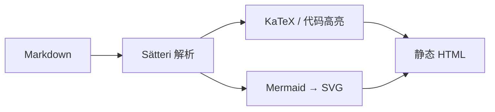
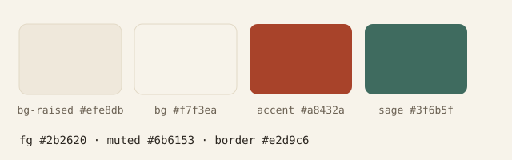

> 这是一篇**示例文章**（Markdown Example）：把本站支持的所有写法集中展示一遍。
> 写新文章时可以对照本页，也可以直接复制这里的片段。

## 写在前面

文章的元信息写在文件顶部的 frontmatter 里，常用字段如下：

```yaml title="frontmatter 示例"
---
title: "文章标题" # 必填
description: "一句话摘要" # 必填，用于列表、RSS 与 meta
pubDatetime: 2026-10-26T10:00:00+08:00 # 必填
category: 算法 # 文章类型：题解 / 题目 / 算法
series: 动态规划入门 # 有先后顺序的一组文章
tags: [动态规划, 洛谷] # 来源、题号、所用算法……
measure: cjk # 栏宽口径，可省略（按正文自动判断）
toc: true # 右侧目录，默认开启
math: true # 加载公式样式，纯文字文章可设 false
draft: false # true 时不参与构建
---
```

## 标题

支持二到五级标题，二级标题会自动出现在右侧目录里。

### 三级标题

#### 四级标题

##### 五级标题

## 段落与行内元素

普通段落里可以混排各种行内元素：**粗体**、*斜体*、~~删除线~~、`行内代码`、<mark>高亮</mark>、<kbd>Ctrl</kbd> + <kbd>C</kbd>、H~2~O 与 x^2^、<abbr title="HyperText Markup Language">HTML</abbr>。

链接分两种：[站外链接](https://astro.build)（自动带 ↗ 角标）与[站内链接](/posts/)（保持普通下划线）。引用一篇文章可以直接写 [[p1002-guo-he-zu]]，也可以自定义文字 [[p1002-guo-he-zu|「洛谷 P1002」过河卒]]，或者跳到本文的某个小节 [[#中文排版]]。

### 中文排版

中英混排时会自动在中英文之间留出间距：Astro 7 用 TypeScript 写了 3 个工具函数，Kaggle 数据集有 1.2 万条记录，复杂度是 $O(n \log n)$，常数是 1e-9。

引号用「」或""都好看；破折号——比如这样——两端会自动对齐。全角标点（，。！？）后面的空隙也会被压掉，不会在行尾留下一个空格。

> 行首的「」会被收紧，段落之间的间距是 0.9em，段首缩进默认关闭（可以用 `typography.paragraphIndent` 打开）。

## 列表

无序列表：

- 第一项
- 第二项
  - 嵌套的第二层
  - 嵌套的第二层
- 第三项

有序列表：

1. 读题
2. 想思路
3. 写代码
4. 交题

任务列表：

- [x] 写完题解
- [x] 补上复杂度
- [ ] 等评测结果

## 引用

> 引用块常用来放题面信息或结论。
>
> 它可以包含多个段落。

嵌套引用：

> 外层引用
> > 内层引用

## 提示块

五种类型都可以用，两种写法等价：

> [!NOTE]
> 补充说明，不影响主线。

> [!TIP]
> 一点小技巧。

> [!IMPORTANT]
> 容易被忽略但很关键的地方。

> [!WARNING]
> 容易踩的坑。

> [!CAUTION]
> 危险操作。

也可以用指令写法并自定义标题：

:::tip[自定义标题]
`:::tip[标题]` 与 `> [!TIP]` 等价，中文站点下默认标题是「提示」。
:::

## 表格

GFM 表格，支持三种对齐方式：

| 左对齐 | 居中 | 右对齐 | 说明 |
| :--- | :---: | ---: | --- |
| `O(n)` | $O(n \log n)$ | 128 MB | 时间复杂度 / 空间复杂度 |
| 洛谷 | 普及- | 1s | 来源、难度、限制 |

表格在窄屏可以横向滚动。

## 代码

行内代码用反引号：`std::vector<int>`。

代码块会自动显示语言标签，并且支持这些 meta：

````markdown
```cpp title="main.cpp" {3-5} ins={7} del={8} showLineNumbers
// 你的代码
```
````

| meta | 作用 |
| --- | --- |
| `title="main.cpp"` | 顶栏显示文件名 |
| `{3-5}` | 高亮第 3–5 行 |
| `ins={7}` / `del={8}` | 标记新增 / 删除的行 |
| `"关键字"` | 高亮某个词 |
| `collapse={1-4}` | 折叠区段（可展开） |
| `showLineNumbers` | 显示行号 |

带文件名与高亮行：

```cpp title="main.cpp" {6-8}
#include <bits/stdc++.h>
using namespace std;

int main() {
    ios::sync_with_stdio(false);
    cin.tie(nullptr);
    // 读入 n
    int n;
    cin >> n;
    return 0;
}
```

标记新增与删除的行：

```cpp title="diff.cpp" ins={3} del={4}
int main() {
    int n = 0;   // 新增
    // int m = 1;   // 删除
    cin >> n;
}
```

折叠区段（点击标题展开）：

```cpp title="collapse.cpp" collapse={1-8}
#include <bits/stdc++.h>
using namespace std;

int main() {
    // 这部分默认折叠
    return 0;
}
```

终端样式（`bash` / `sh` 自动使用终端外框）：

```bash title="build.sh"
pnpm install
pnpm build
```

其他语言也一样：

```python title="solve.py"
def solve():
    n = int(input())
    print(n * 2)
```

```javascript title="solve.js"
const solve = (n) => n * 2;
```

## 公式

行内公式用 `$…$`：$e^{i\pi} + 1 = 0$，复杂度写成 $O(n \log n)$。

独立成行的公式用 `$$…$$`：

$$
f(i, j) = \min_{k < j} \bigl\{ f(i-1, k) + w(k, j) \bigr\},\qquad f(0, j) = 0
$$

公式在构建期渲染，不加载任何 JavaScript。

## 图表

Mermaid 图直接写在围栏里：



Excalidraw 图用 `.excalidraw` 文件：


图表在构建期渲染成内联 SVG，可以选中文字、可以被搜索；点击图上角的按钮还能全屏缩放查看。

## 图片

普通图片：



在图片标题里写 `wide` 可以让图片比正文栏更宽，写 `full` 则撑满整个视口：


## 脚注

脚注用来放补充说明[^1]，引用处会自动编号[^2]。

[^1]: 脚注的内容渲染在文章末尾。
[^2]: 也可以有多个脚注。

## 分割线

正文里用三个短横线就能插入一条分割线：

---

## 就这些

上面覆盖了本站支持的全部写法。写作时有任何拿不准的，参照本页即可。
