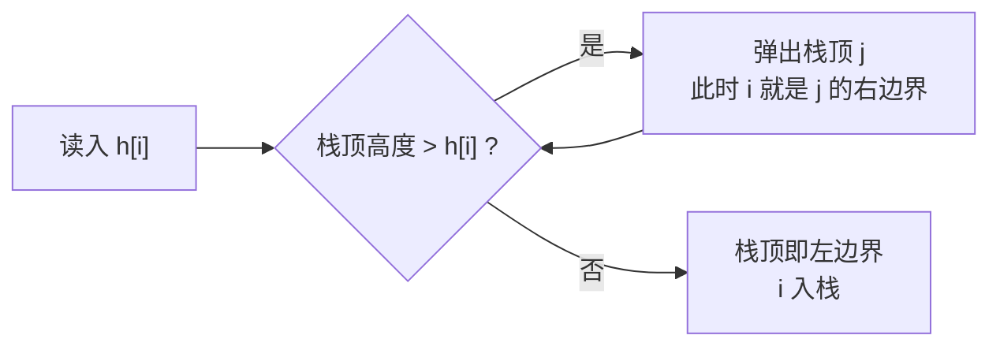

## 问题

给定一个柱状图的高度数组 $h$，求柱状图中能勾勒出的**最大矩形**面积。

暴力做法是枚举左右边界 $O(n^2)$，再用区间最小值算面积，还是 $O(n^3)$。我们想把复杂度压到 $O(n)$。

## 换一个问法

与其枚举区间，不如换个角度：**枚举"谁是最低的那根柱子"**。

如果第 $i$ 根柱子作为矩形里最低的柱子，那么矩形的左右边界分别是：

- $L_i$：左边第一个**严格小于** $h_i$ 的位置；
- $R_i$：右边第一个**严格小于** $h_i$ 的位置。

于是以 $i$ 为最低柱的最大矩形面积就是：

$$
A_i = h_i \times (R_i - L_i - 1)
$$

答案取 $\max A_i$。现在问题变成：**怎么在线性时间内求出每个位置的左右第一个更小值？**

## 单调栈

维护一个栈，栈里存下标，对应的高度**单调递增**（栈底到栈顶）。从左往右扫描：

对每个位置 $i$：

1. 当栈非空且 $h[\text{栈顶}] \ge h_i$ 时，弹出栈顶 $j$。此时 $i$ 就是 $j$ 的**右边界**（第一个更小的位置）。
2. 弹完后若栈还非空，栈顶就是 $j$ 的**左边界**；若栈空，说明 $j$ 左边没有更小的，$L_j = -1$。
3. 把 $i$ 入栈。

每个下标最多入栈一次、出栈一次，所以总复杂度是 $O(n)$。

> [!WARNING]
> 上面用 $\ge$ 而不是 `>`，对应的是"严格更小"的定义。如果题目允许相等的柱子也算边界，就要改成 `>`，两种写法的答案在有重复高度时会不同。

## 复杂度

- 时间：$O(n)$，每个元素进出栈各一次。
- 空间：$O(n)$。

## 什么时候想到它

经验上，当题目出现下面这些信号时，可以往单调栈上想：

| 信号 | 例子 |
|---|---|
| 求"每个位置左右第一个更大/更小的元素" | 每日温度、柱状图最大矩形 |
| 需要 O(n) 求出所有区间的最优值 | 接雨水、跳跃游戏 II |
| 括号匹配、滑动窗口最值 | 表达式求值 |

关键词是 **"第一个"** 和 **"连续区间"**。如果题目问的是"任意区间"，那多半该往线段树或 ST 表上想。
